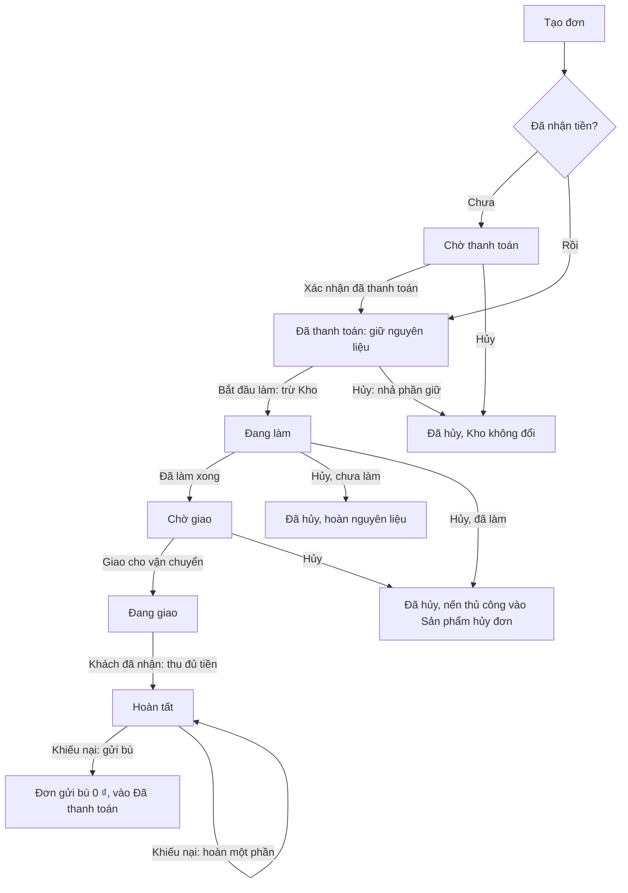
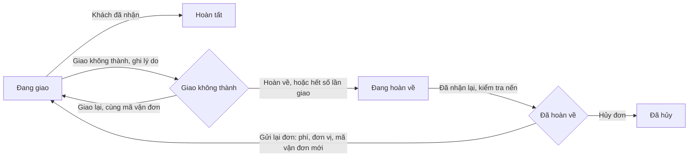

# Workflow đơn hàng: từ lên đơn tới giao thành công

Tài liệu để chủ shop duyệt quy trình. Mỗi bước ghi rõ ai làm, bấm gì ở BO, hệ thống kiểm tra gì và kết quả ra sao.

Toàn bộ quy trình dưới đây đã chạy được ở BO. BO hiện lưu dữ liệu trên trình duyệt, chưa nối BE và web.

## 1. Sơ đồ tổng

Trước khi Bắt đầu làm, đơn sửa được cả sản phẩm; sau đó chỉ sửa liên hệ, địa chỉ, giao hàng, ghi chú. Xem [Đơn hàng › Sửa đơn](./pages/orders.md#sửa-đơn).

## 2. Chuẩn bị trước khi có đơn

| Việc | Trang | Vì sao cần |
|---|---|---|
| Nhập nguyên liệu | [Kho nguyên liệu](./pages/inventory.md) | Hết nguyên liệu thì lựa chọn tự phối bị khóa |
| Cấu hình các bước tự phối rồi bấm Lưu | [Thủ công](./pages/craft.md) | Tạo đơn chỉ dùng bản đã lưu, không dùng bản nháp |
| Tạo mẫu nến kèm công thức | [Sản phẩm trưng bày](./pages/products.md) | Công thức dùng để giữ và trừ Kho khi khách đặt |
| Đặt % cọc, phí vận chuyển, số lần giao tối đa, phí gửi lại | [Cài đặt](./pages/settings.md) | Đơn mới lấy các số này |
| Tạo mã giảm giá (nếu có) | [Mã giảm giá](./pages/discounts.md) | Áp dụng lúc tạo đơn |

## 3. Luồng chính

### Bước 1. Lên đơn

**Ai làm:** khách đặt trên web (chưa nối) hoặc admin tạo ở BO khi khách đặt qua điện thoại, Zalo, Facebook, tại cửa hàng.

Admin bấm **Tạo đơn hàng** rồi điền:

1. **Khách hàng:** chọn hồ sơ có sẵn hoặc nhập mới. Chọn hồ sơ thì tự điền tên, SĐT, email, địa chỉ giao gần nhất. Khách từng giao lỗi thì hiện số lần.
2. **Sản phẩm:** thêm **Nến có sẵn** (chọn mẫu, lấy giá của mẫu) hoặc **Tự phối nến** (đi qua các bước Thủ công, giá tự tính). Nến tự phối chọn được nhiều loại sáp và chỉnh lượng từng nguyên liệu, để trống thì theo mặc định. Công thức này lưu riêng cho nến đó trên đơn.
3. **Giao hàng:** chọn phương thức, phí tự điền và sửa được cho đơn này; chọn ngày xưởng làm xong.
4. **Thanh toán:** nhập mã giảm giá, chọn đặt cọc hoặc trả đủ, chọn kênh thanh toán, bật "Đã nhận tiền" nếu khách đã chuyển.

**Hệ thống chặn tạo đơn khi:**

- Chưa có sản phẩm nào.
- Mã giảm giá không dùng được.
- Không đủ nguyên liệu cho cả đơn, tính trên số **dùng được** (tồn Kho trừ phần các đơn khác đang giữ). Áp dụng cho cả nến tự phối và nến có sẵn có công thức.

Khách đang bị chặn thì hỏi lại, admin vẫn có thể tạo.

**Kết quả:**

- Đơn có mã dạng `SC261102001`.
- Trạng thái **Đã thanh toán** nếu đã nhận tiền, ngược lại là **Chờ thanh toán**.
- Đơn lưu lại % cọc, phương thức và phí giao; đổi Cài đặt sau đó không ảnh hưởng đơn này.
- Số điện thoại mới thì tạo hồ sơ khách.
- Mã giảm giá tăng 1 lượt dùng.
- **Kho chưa bị trừ.**

**Nến tự phối:**

| Nội dung | Quy tắc |
|---|---|
| Số lựa chọn | Mỗi bước chọn 1 hay nhiều mục theo [Thủ công](./pages/craft.md#chọn-1-hoặc-chọn-nhiều). Sáp, Màu sáp, Trang trí mặc định chọn nhiều |
| Lượng cho 1 hũ | Sáp (g), mùi hương (ml), màu (ml), bấc, trang trí, tuỳ chọn thêm có ô nhập. Để trống thì theo mặc định. Hũ và nắp luôn 1 cái |
| Mặc định khi chọn nhiều | Sáp và màu chia đều cho số loại. Ví dụ hũ 150ml đổ 120g sáp, chọn 2 loại thì mỗi loại 60g |
| Phụ thu sáp, màu | Theo tỉ lệ lượng, làm tròn tới nghìn đồng. Ví dụ Sáp dừa +25.000 ₫ chiếm 60g trong 160g thì cộng 9.000 ₫ |
| Phụ thu mùi | Theo tỉ lệ phối, hoặc theo ml nếu admin điền |
| Phụ thu hương | Tới mức chuẩn tính số mặc định, vượt thì tăng theo ml. Ví dụ chuẩn 10% với 120g sáp là 12 ml, phụ thu 10.000 ₫: 18 ml thành 15.000 ₫. Không mùi thì không tính |
| Phụ thu độ đậm | Cộng riêng theo cài đặt ở Thủ công |
| Công thức | Lưu riêng cho cây nến đó trên đơn. Đổi Thủ công sau đó không ảnh hưởng đơn đã tạo |

### Bước 2. Xác nhận thanh toán

**Ai làm:** admin.

Bấm **Xác nhận đã thanh toán**. Khoản thu đang chờ chuyển thành thành công. Đơn sang **Đã thanh toán**.

**Giữ nguyên liệu:** từ lúc nhận cọc hoặc đủ tiền, đơn giữ nguyên liệu. Tồn Kho chưa đổi, nhưng đơn khác không dùng được phần này. Trang Kho hiện "Đang giữ … · Dùng được …".

Nếu không còn đủ để giữ, hệ thống báo trước và admin chọn **Vẫn xác nhận** hoặc quay lại, vì tiền đã về thì không nên chặn.

### Bước 3. Bắt đầu làm

**Ai làm:** admin hoặc xưởng.

Bấm **Bắt đầu làm**. Hệ thống tính nguyên liệu của cả đơn: nến tự phối theo công thức lưu trên đơn, nến có sẵn theo công thức của sản phẩm.

- **Đủ:** trừ Kho, mỗi nguyên liệu một phiếu "Theo đơn hàng", phần giữ được nhả, đơn sang **Đang làm**.
- **Thiếu:** không cho bắt đầu, liệt kê nguyên liệu thiếu. Admin nhập thêm hoặc kiểm kê rồi bấm lại.

Sản phẩm chưa có công thức thì không giữ và không trừ Kho, danh sách sản phẩm có nhãn "Chưa có công thức". Với nến có sẵn, đơn chưa bắt đầu làm dùng công thức mới nhất của sản phẩm.

### Bước 4. Làm xong

**Ai làm:** xưởng.

Bấm **Đã làm xong**. Đơn sang **Chờ giao**.

### Bước 5. Giao cho vận chuyển

**Ai làm:** admin.

1. Đóng gói, bấm **In** ở chi tiết đơn để in phiếu đơn bỏ vào hộp và nhãn giao hàng dán ngoài. Nhiều đơn thì chọn trên danh sách tab Chờ giao rồi in một lần.
2. Tạo đơn trên app đơn vị vận chuyển, nhập số tiền thu hộ (COD) đúng bằng số khách còn phải trả.
3. Bấm **Giao cho vận chuyển**, chọn đơn vị và nhập mã vận đơn. Đơn sang **Đang giao**. Từ đây không hủy trực tiếp được nữa.

Khách hỏi đơn tới đâu: mở đơn, bấm **Tra cứu** hoặc sao chép mã vận đơn. Chi tiết ở [Đơn hàng › Vận chuyển](./pages/orders.md#vận-chuyển).

### Bước 6. Giao thành công

**Ai làm:** admin.

Bấm **Khách đã nhận**. Nút này đồng nghĩa shop đã thu đủ tiền. Đơn còn phần chưa thu thì hệ thống hỏi xác nhận rồi tự ghi nhận khoản thu đó. Đơn sang **Hoàn tất**, không còn nợ, tính vào số liệu khách hàng.

## 4. Hủy đơn

Hủy được trước khi giao, hoặc sau khi hàng đã hoàn về shop. Mọi trường hợp đều nhập lý do và **trả lại 1 lượt mã giảm giá** nếu đơn có dùng mã.

| Hủy ở trạng thái | Hỏi thêm | Kho | Nến |
|---|---|---|---|
| Chờ thanh toán | | Không đổi | Chưa làm |
| Đã thanh toán | | Nhả phần giữ | Chưa làm |
| Đang làm, đơn có nến thủ công | "Bạn đã thực hiện làm sản phẩm này chưa?" | Chưa làm: hoàn đúng lượng đã trừ. Đã làm: không hoàn | Đã làm: nến thủ công vào [Sản phẩm hủy đơn](./pages/cancelled-products.md) |
| Đang làm, đơn toàn nến có sẵn đã trừ Kho | "Bạn đã thực hiện làm sản phẩm này chưa?" | Chưa làm: hoàn đúng lượng đã trừ. Đã làm: không hoàn | Không tạo gì |
| Đang làm, đơn toàn nến có sẵn chưa có công thức | | Không đổi | Không tạo gì |
| Chờ giao, đơn có nến thủ công | | Không hoàn | Nến thủ công vào Sản phẩm hủy đơn |
| Chờ giao, đơn toàn nến có sẵn | | Không hoàn | Không tạo gì |
| Đã hoàn về, nến còn tốt | | Không hoàn | Nến thủ công vào Sản phẩm hủy đơn |
| Đã hoàn về, nến hỏng | | Không hoàn | Không tạo gì |

## 5. Hoàn tiền

Đơn đã thu tiền thì popup hủy bắt buộc chọn **Lỗi do khách** hoặc **Lỗi do shop**, rồi hiện ngay số tiền phải hoàn.

| Lỗi do | Khách đã trả | Hoàn cho khách |
|---|---|---|
| Khách | Mới đặt cọc | Không hoàn, shop giữ cọc |
| Khách | Trả đủ | Tổng tiền − tiền cọc |
| Shop | Đặt cọc hoặc trả đủ | Toàn bộ tiền đã thu |

Tiền cọc tính theo % lưu trên đơn, trên **tiền hàng** (tạm tính − giảm giá), không gồm phí giao và phí gửi lại.

Sau khi hủy, đơn có số phải hoàn sẽ hiện **Chờ hoàn tiền** và có thông báo trên chuông. Admin chuyển tiền cho khách ngoài hệ thống, rồi bấm **Ghi nhận đã hoàn tiền** ở khối Thanh toán:

- **Số tiền đã hoàn:** tự điền, sửa được, không vượt quá số đã thu.
- **Ảnh chứng từ:** bắt buộc ít nhất 1 ảnh.
- **Ghi chú:** tùy chọn.

Đơn chuyển sang **Đã hoàn tiền**, hiện ảnh, thời gian và người ghi nhận.

## 6. Giao hàng lỗi

| Bước | Nút | Hệ thống làm gì |
|---|---|---|
| Đang giao | **Giao không thành** | Bắt buộc nhập lý do, đếm 1 lần giao. Sang **Giao không thành** |
| Giao không thành | **Giao lại** | Hàng còn ở đơn vị vận chuyển, họ giao lại: giữ đơn vị và mã vận đơn, về **Đang giao** |
| Giao không thành | **Hoàn về** | Sang **Đang hoàn về** |
| Hết số lần giao | Tự động | Lần cuối ghi nhận xong thì đơn tự sang **Đang hoàn về**. Số lần lấy từ Cài đặt |
| Đang hoàn về | **Đã nhận lại hàng** | Chọn nến còn tốt hoặc bị hỏng, phí hoàn hàng trả đơn vị vận chuyển (trừ vào lãi), ghi chú tùy chọn. Sang **Đã hoàn về** |
| Đã hoàn về | **Gửi lại đơn** | Hàng đã về shop nên chọn lại đơn vị vận chuyển (mặc định đơn vị lần trước, đổi được) và nhập mã vận đơn mới, không dùng lại mã cũ. Phí mặc định lấy từ Cài đặt, sửa được, cộng vào tổng đơn; popup báo số thu hộ mới. Đếm lại số lần giao, đơn sang thẳng **Đang giao**. Lịch sử giữ mã lần trước |
| Đã hoàn về | **Hủy đơn** | Theo [mục 4](#4-hủy-đơn) và [mục 5](#5-hoàn-tiền) |

Quy tắc:

- **Không hủy khi hàng chưa về shop:** ở Đang giao, Giao không thành, Đang hoàn về không có nút hủy.
- **Nến hỏng khi hoàn về:** chỉ ghi vào đơn, không tạo phiếu kho vì nguyên liệu đã trừ lúc làm. Gửi lại thì popup nhắc kiểm tra hoặc thay nến.
- **Phí gửi lại:** thu cùng phần còn lại khi bấm Khách đã nhận.
- **Theo dõi:** trang Đơn hàng có thẻ **Giao lỗi cần xử lý** và các tab riêng. Đơn Giao không thành, Đã hoàn về có thông báo và tính vào số trên menu.
- **Khách hay bom hàng:** số lần giao không thành hiện trên hồ sơ khách, chi tiết đơn và lúc tạo đơn.

## 7. Khiếu nại sau khi giao

Chỉ đơn **Hoàn tất** có nút **Khiếu nại**. Admin ghi nội dung khách phản ánh, ảnh khách gửi (không bắt buộc) và chọn một cách xử lý:

| Cách xử lý | Kết quả |
|---|---|
| Gửi bù nến mới | Tạo đơn mới 0 ₫ cùng khách, địa chỉ, chọn cây và số lượng (không quá đơn gốc). Đơn vào thẳng **Đã thanh toán** để giữ nguyên liệu, rồi đi qua đủ các bước làm, giao. Kho thiếu thì không tạo được |
| Hoàn một phần tiền | Ghi khoản hoàn kèm ảnh chứng từ (bắt buộc), tối đa số tiền shop đang giữ. Doanh thu trừ vào ngày hoàn |
| Chỉ ghi nhận | Lưu khiếu nại, không bồi thường |

- Đơn gốc vẫn là Hoàn tất, có khối **Khiếu nại** và nhãn "Khiếu nại" trên bảng đơn. Lịch sử ghi lại khiếu nại.
- Đơn gửi bù có nhãn "Gửi bù" và link về đơn gốc. Đơn này **không tính** vào số đơn, giá trị đơn trung bình, khách hàng mới, số lần mua của khách; giá vốn của nó **có tính** vào lãi gộp (lãi âm).

## 8. Quyết định đã chốt

- **Sửa đơn:** đổi sản phẩm chỉ khi Chờ thanh toán hoặc Đã thanh toán. Mã giảm giá cũ giữ được khi sửa dù đã hết hạn hay hết lượt, vì đã hợp lệ lúc đặt; vẫn kiểm tra lại đơn tối thiểu và phạm vi.
- **Thu dư sau khi sửa đơn:** báo "Thu dư, cần hoàn", admin ghi nhận đã hoàn kèm ảnh chứng từ. Khoản này không làm giảm giá trị hàng khi tính lãi.
- **Công suất xưởng chỉ cảnh báo,** không chặn nhận đơn hay đổi ngày.

- **Lỗi do khách áp dụng cả khi hủy trước lúc giao:** ví dụ khách đổi ý lúc Đã thanh toán thì shop giữ cọc.
- **Web dùng cùng quy tắc Kho với BO khi nối BE:** nến tự phối giới hạn theo số dùng được, gồm cả phần đang giữ.
